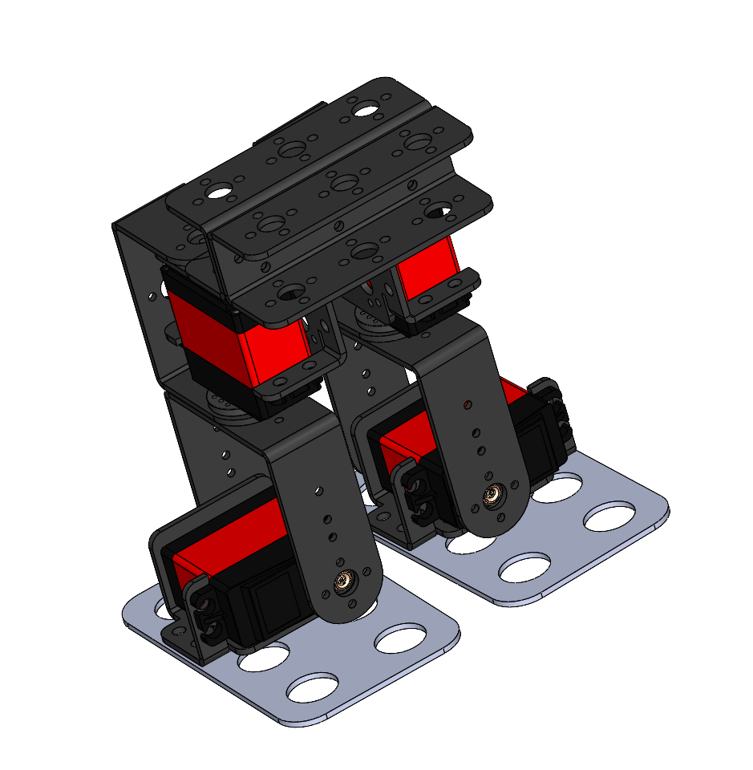

# Sim-Biped-Walker

A MuJoCo simulation of a 4-DoF biped walker with **3 × 5 tactile sensor arrays
under each foot**, a Gymnasium environment for **energy-efficient forward
walking and turning**, and RL agents (PPO and evolution strategies) that share
a common base class.

 

## Install

```bash
pip install -e .            # mujoco, gymnasium, numpy, imageio
pip install -e ".[ppo]"     # + stable-baselines3 / torch for PPO
pip install -e ".[examples]"  # + matplotlib for the tactile plot demo
```

## Layout

```
biped_walker/
  model.py          procedural MJCF: meshes, servos, tactile pads + touch sensors
  robot.py          Biped: low-level MuJoCo control and sensor readout
  envs/walker_env.py  BipedWalkerEnv (Gymnasium)
  rl/base.py        BaseRLAgent: train / predict / evaluate / visualize(record=...) / save / load
  rl/ppo.py         PPOAgent (Stable-Baselines3 + VecNormalize)
  rl/es.py          ESAgent (pure-NumPy OpenAI-ES, multiprocessing)
  utils/video.py    mp4/gif writer
  assets/meshes/    STL meshes from the CAD export
examples/
  train.py          train PPO or ES
  visualize.py      watch / record a trained agent
  sine_gait.py      open-loop gait through the env, prints foot loads
  tactile_demo.py   drive servos with Biped and plot the foot pressure maps
tests/              pytest
cad/                SolidWorks assembly
legacy/             old PyBullet code, GA experiments, URDF export
```

## The robot

An Otto-style walker: each leg has a **hip that yaws** about the vertical axis
and an **ankle that rolls** the foot about the forward axis. Joint and action
order everywhere is `(left_hip, left_ankle, right_hip, right_ankle)`.

* **Servos** are MuJoCo position actuators (kp 3 N m/rad, 0.35 N m torque
  limit, damping and armature to mimic a hobby servo). Hip range ±1.0 rad,
  ankle range ±0.7 rad. All of this lives in `ModelConfig`.
* **Tactile feet.** The flat sole of each foot is tiled with a grid of thin box
  pads, 3 across the width and 5 heel to toe. Each pad is the foot's
  contact surface at that spot and has a MuJoCo `touch` sensor reporting its
  normal force in newtons. `Biped.tactile()` returns shape `(2, 3, 5)`
  `[foot, across (robot-left→right), along (heel→toe)]`. The grid is
  configurable: `ModelConfig(tactile=TactileConfig(cols=4, rows=8))`.
* The robot spawns facing world **+x**; positive yaw rate means turning left.

```python
from biped_walker import Biped
bot = Biped()
bot.reset(settle_steps=200)
bot.set_targets([0.3, 0.0, 0.3, 0.0])   # radians
bot.step(50)
print(bot.joint_positions(), bot.tactile().sum(axis=(1, 2)))
```

To look at the model directly: `python -c "import biped_walker; biped_walker.write_mjcf('walker.xml')"`
then `python -m mujoco.viewer --mjcf walker.xml`.

## The environment

| id | task |
|---|---|
| `SimBiped-v0` | mixed: walk forward, turn on the spot, or walk in arcs |
| `SimBiped-Forward-v0` | walk straight ahead |
| `SimBiped-Turn-v0` | turn left/right on the spot |

Each episode samples a velocity command (forward speed m/s, yaw rate rad/s),
from `CommandConfig` ranges, or you can pass a fixed `command=[v, w]`.
Episodes run for 1000 control steps (20 s at 50 Hz).

**Observation**: the last `history_len` (default 3) frames of

* 30 tactile values (2 feet × 3 × 5), force / `tactile_max_force`, clipped to [0, 1]
* 4 motor positions normalised to [-1, 1]

plus the normalised 2-value command. The command is what tells one policy
whether to walk or turn; use `include_command=False` with a fixed command if
you want the observation to be tactile + motor positions only. Stacking a few
frames lets the policy infer motion, because a single frame of
tactile + joint angles carries no velocity information.

**Action**: 4 servo targets in [-1, 1], mapped to the joint ranges.

**Reward** (weights in `RewardConfig`):

* `+ exp(-((v − v_cmd)/σ)²)`: forward speed tracking
* `+ 0.5 · exp(-((ω − ω_cmd)/σ)²)`: yaw rate tracking
* `− 0.2 · Σ|τ·q̇|`: absolute mechanical power of the servos, which drives efficiency
* `− action rate − sideways drift − body tilt`, and `−5` on falling

`info` reports velocities, power, energy, distance, **cost of transport**,
the raw `(2, 3, 5)` tactile forces and joint angles. Options:
`randomize_dynamics=True` (friction and mass randomisation),
`tactile_noise`, `joint_noise`.

## Training and visualising

```bash
python examples/train.py --algo ppo --task mixed --timesteps 3000000 --n-envs 8
python examples/train.py --algo es --task forward --timesteps 2000000 --workers 8

python examples/visualize.py runs/ppo_mixed/latest --command 0.05 0     # walk
python examples/visualize.py runs/ppo_mixed/latest --command 0 0.4      # turn left
python examples/visualize.py runs/ppo_mixed/latest --record --no-show --video walk.mp4
```

In code:

```python
from biped_walker.rl import PPOAgent, ESAgent, load_agent

agent = PPOAgent(env_id="SimBiped-v0", n_envs=8)      # or ESAgent(...)
agent.train(3_000_000, log_dir="runs/ppo")
agent.save("runs/ppo/final")
print(agent.evaluate(n_episodes=5))
agent.visualize(n_episodes=2, record=True, video_path="videos/walk.mp4", command=(0.05, 0.0))

agent = load_agent("runs/ppo/final")                    # picks the right class
```

`visualize(record=True)` renders offscreen and writes an mp4 (or gif);
`show=False` skips the viewer. On a headless machine set `MUJOCO_GL=egl` (GPU)
or `MUJOCO_GL=osmesa` (CPU). On macOS the interactive viewer needs `mjpython`.

To add another algorithm, subclass `BaseRLAgent` and implement `train`,
`predict`, `_save` and `_load`; evaluation, visualisation and recording come
for free.

## Tests

```bash
pytest tests
```
