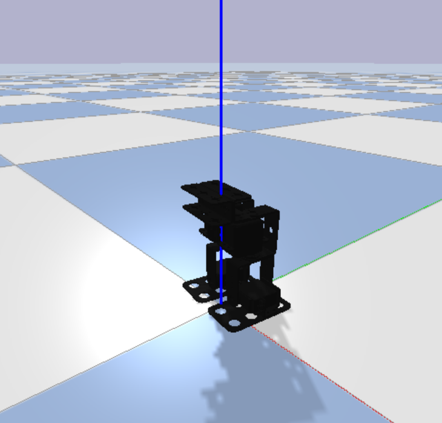
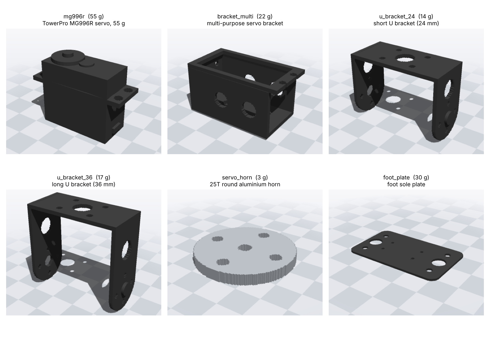

# Sim-Biped-Walker

MuJoCo simulations of tactile-footed biped robots, with **3 × 5 tactile sensor
arrays under each foot**, Gymnasium environments for **energy-efficient
forward walking and turning**, and RL agents (PPO and evolution strategies)
that share a common base class.

Two robot bodies are included:

| `walker4`: 4-DoF walker | `biped8`: 8-DoF servo-bracket biped |
|---|---|
|  |  |
| Otto-style: hip yaw + ankle roll per leg | hip roll, hip pitch, knee, ankle roll per leg |
| ~0.34 kg, small hobby servos | ~1.42 kg, 0.29 m tall, 8 × MG996R in aluminium servo brackets |
| CAD: `cad/walker_assembly.SLDASM` | CAD: `cad/biped8/` (OpenSCAD) |

## Install

```bash
pip install -e .              # mujoco, gymnasium, numpy, imageio
pip install -e ".[ppo]"       # + stable-baselines3 / torch for PPO
pip install -e ".[examples]"  # + matplotlib for plots and CAD renders
```

## Layout

```
biped_walker/
  robots/           robot bodies: walker4.py, biped8.py, registry in __init__.py
  robot.py          Biped: low-level MuJoCo control and sensor readout (any robot)
  envs/walker_env.py  BipedWalkerEnv (Gymnasium)
  rl/base.py        BaseRLAgent: train / predict / evaluate / visualize(record=...) / save / load
  rl/ppo.py         PPOAgent (Stable-Baselines3 + VecNormalize)
  rl/es.py          ESAgent (pure-NumPy OpenAI-ES, multiprocessing)
  cad/              NumPy mirror of the biped8 OpenSCAD parts, layout, renderer
  utils/video.py    mp4/gif writer
  assets/walker4/   walker4 STL meshes (SolidWorks export)
  assets/biped8/    biped8 STL meshes + generated model data
examples/
  train.py          train PPO or ES on either robot
  visualize.py      watch / record a trained agent
  sine_gait.py      open-loop walker4 gait, prints foot loads
  biped8_demo.py    scripted squats and weight shifts on biped8
  tactile_demo.py   drive servos with Biped and plot the foot pressure maps
cad/
  walker_assembly.SLDASM   walker4 SolidWorks assembly
  biped8/                  biped8 OpenSCAD parts, assembly, STL export script
tests/              pytest
legacy/             old PyBullet code, GA experiments, URDF export
```

## The robots

Pick a robot with `Biped("walker4")` / `Biped("biped8")`, or with
`robot=` on the environment. Joint and action order is `bot.joint_names`.

### walker4

An Otto-style walker: each leg has a **hip that yaws** about the vertical axis
and an **ankle that rolls** the foot about the forward axis. Joints:
`(left_hip, left_ankle, right_hip, right_ankle)`. Servos are position
actuators (kp 3 N m/rad, 0.35 N m torque limit). Hip range ±1.0 rad, ankle
range ±0.7 rad (`Walker4Config`).

### biped8

An 8-DoF biped built from standard aluminium robot servo brackets and
TowerPro MG996R servos, like the classic hobby biped kits. Each leg has
**hip roll, hip pitch, knee and ankle roll**:
`left_hip_roll, left_hip_pitch, left_knee, left_ankle_roll`, then the same
for `right_`. The servos lie on their sides (brackets bolted by their large
side walls) and the ankle-roll servos lie flat across the feet with their
horns facing forwards, which keeps the legs
short and the centre of mass low.

* The brackets, foot plates and body were designed in OpenSCAD
  (`cad/biped8/biped8_parts.scad`) and assembled into legs (`cad/biped8/assembly.scad`).
  The masses and inertias come from those part geometries. See
  [cad/biped8/README.md](cad/biped8/README.md).
* The servo model follows the MG996R at 6 V: about 1.08 N m stall torque,
  about 7.5 rad/s no-load speed (as joint damping) and gearbox armature
  (`Biped8Config`).
* Both legs are mirrored so that equal commands give mirror-symmetric motion:
  +hip roll swings a leg outwards, +hip pitch swings the thigh forward, the
  knee bends with negative angles, +ankle roll tips the shin outwards over the foot.
* Joint limits stay inside the bracket clearances of the CAD layout.
* Actions are offsets from a standing pose (hip pitch 0.25, knee −0.25 rad:
  thigh slightly forward, shin vertical, foot flat), scaled per joint
  (`stand_pose`, `action_scales`). With no ankle pitch, the foot stays flat
  while `knee = −hip_pitch`.



### Tactile feet (both robots)

The flat sole of each foot is tiled with a grid of thin box pads, 3 across
the width and 5 heel to toe. Each pad is the foot's contact surface at that
spot and has a MuJoCo `touch` sensor reporting its normal force in newtons.
`Biped.tactile()` returns shape `(2, 3, 5)`:
`[foot, across (robot-left→right), along (heel→toe)]`. The grid is
configurable, e.g. `Biped8Config(tactile=TactileConfig(cols=4, rows=8))`.

```python
from biped_walker import Biped
bot = Biped("biped8")
bot.reset(settle_steps=200)                  # standing pose
bot.set_normalized([0.0] * bot.n_joints)    # hold the standing pose
bot.step(50)
print(bot.joint_positions(), bot.tactile().sum(axis=(1, 2)))
```

To look at a model directly:
`python -c "import biped_walker; biped_walker.write_mjcf('b8.xml', robot='biped8')"`
then `python -m mujoco.viewer --mjcf b8.xml`.

## The environment

| id | robot | task |
|---|---|---|
| `SimBiped-v0` | walker4 | mixed: walk forward, turn on the spot, or walk in arcs |
| `SimBiped-Forward-v0` | walker4 | walk straight ahead |
| `SimBiped-Turn-v0` | walker4 | turn left/right on the spot |
| `SimBiped8-v0` | biped8 | mixed |
| `SimBiped8-Forward-v0` | biped8 | walk straight ahead |
| `SimBiped8-Turn-v0` | biped8 | turn on the spot |

Each episode samples a velocity command (forward speed m/s, yaw rate rad/s)
from `CommandConfig` ranges, or you can pass a fixed `command=[v, w]`. Each
robot has its own default ranges and reward weights (in its `RobotSpec`), for
example faster target speeds and a smaller power penalty per watt for the
heavier biped8. Episodes run for 1000 control steps (20 s at 50 Hz).

**Observation**: the last `history_len` (default 3) frames of

* 30 tactile values (2 feet × 3 × 5), force / `tactile_max_force`, clipped to [0, 1]
* the motor positions (4 or 8), in the same normalised units as the action

plus the normalised 2-value command. The command is what tells one policy
whether to walk or turn; use `include_command=False` with a fixed command if
you want the observation to be tactile + motor positions only. Stacking a few
frames lets the policy infer motion, because a single frame of
tactile + joint angles carries no velocity information.

**Action**: one servo target per joint in [-1, 1], mapped to
`default_pose + action × action_scale`.

**Reward** (weights in `RewardConfig`):

* `+ exp(-((v − v_cmd)/σ)²)`: forward speed tracking
* `+ 0.5 · exp(-((ω − ω_cmd)/σ)²)`: yaw rate tracking
* `− w_energy · Σ|τ·q̇|`: absolute mechanical power of the servos, which drives efficiency
* `− action rate − sideways drift − body tilt`, and `−5` on falling

`info` reports velocities, power, energy, distance, **cost of transport**,
the raw `(2, 3, 5)` tactile forces and joint angles. Options:
`randomize_dynamics=True` (friction and mass randomisation),
`tactile_noise`, `joint_noise`.

## Training and visualising

```bash
python examples/train.py --robot walker4 --algo ppo --task mixed --timesteps 3000000 --n-envs 8
python examples/train.py --robot biped8 --algo ppo --task forward --timesteps 10000000 --n-envs 16
python examples/train.py --robot biped8 --algo es --task forward --timesteps 5000000 --workers 8

python examples/visualize.py runs/walker4_ppo_mixed/latest --command 0.05 0     # walk
python examples/visualize.py runs/walker4_ppo_mixed/latest --command 0 0.4      # turn left
python examples/visualize.py runs/biped8_ppo_forward/latest --record --no-show --video walk.mp4
```

In code:

```python
from biped_walker.rl import PPOAgent, ESAgent, load_agent

agent = PPOAgent(env_id="SimBiped8-v0", n_envs=8)    # or ESAgent(...)
agent.train(10_000_000, log_dir="runs/b8")
agent.save("runs/b8/final")
print(agent.evaluate(n_episodes=5))
agent.visualize(n_episodes=2, record=True, video_path="videos/walk.mp4", command=(0.08, 0.0))

agent = load_agent("runs/b8/final")                   # picks the right class and robot
```

`visualize(record=True)` renders offscreen and writes an mp4 (or gif);
`show=False` skips the viewer. On a headless machine set `MUJOCO_GL=egl` (GPU)
or `MUJOCO_GL=osmesa` (CPU). On macOS the interactive viewer needs `mjpython`.

To add another algorithm, subclass `BaseRLAgent` and implement `train`,
`predict`, `_save` and `_load`; evaluation, visualisation and recording come
for free. To add another robot, write a module like `robots/biped8.py`
(a config class and `build_mjcf`) and register its `RobotSpec` in
`robots/__init__.py`.

## Regenerating the biped8 CAD data

```bash
python -m biped_walker.cad.biped8_design   # meshes, model data, cad/biped8/assembly.scad
python -m biped_walker.cad.render           # docs/biped8*.png
cad/biped8/export_stl.sh                   # STLs via OpenSCAD (needs openscad)
```

## Tests

```bash
pytest tests
```
