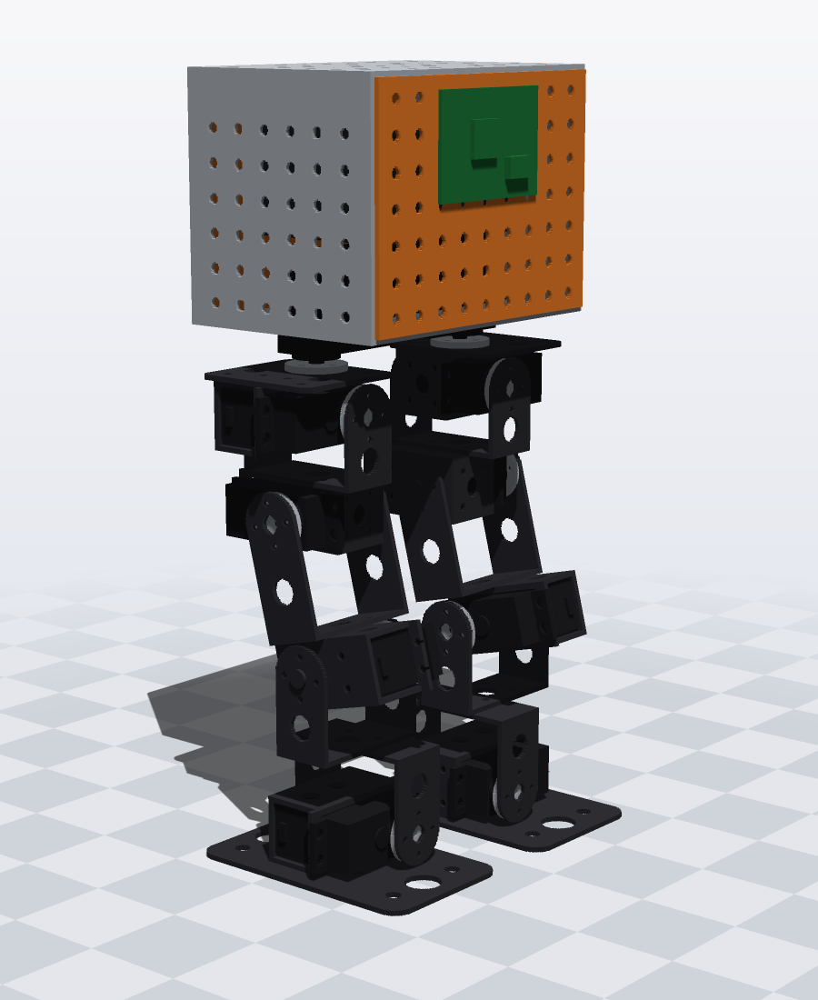
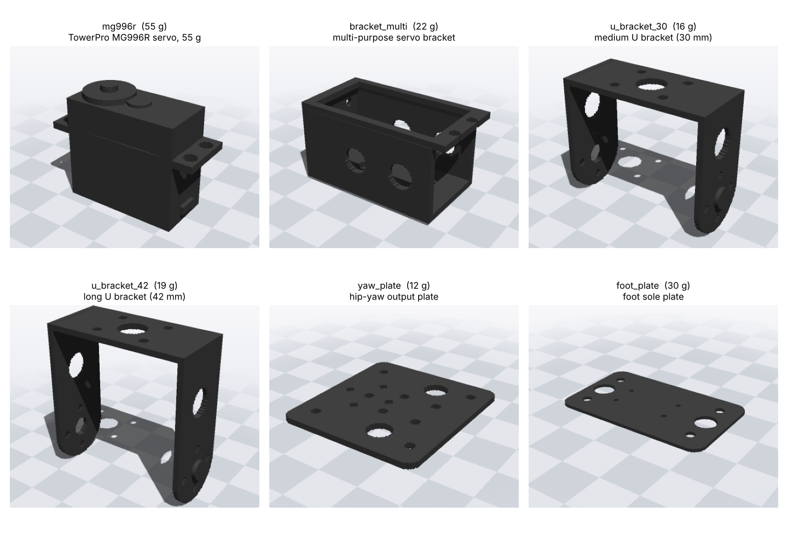

# Sim-Biped-Walker

MuJoCo simulations of tactile-footed biped robots, with **3 × 5 tactile sensor
arrays under each foot**, Gymnasium environments for **energy-efficient
forward walking and turning**, and RL agents (PPO and evolution strategies)
that share a common base class.

Two robot bodies are included:

| `walker4`: 4-DoF walker | `biped10`: 10-DoF servo-bracket biped |
|---|---|
|  |  |
| Otto-style: hip yaw + ankle roll per leg | hip yaw, hip roll, hip pitch, knee, ankle roll per leg |
| ~0.34 kg, small hobby servos | ~1.55 kg, 0.30 m tall, 10 × MG996R in aluminium servo brackets |
| CAD: `cad/walker_assembly.SLDASM` | CAD: `cad/biped10/` (OpenSCAD) |

## Install

```bash
pip install -e .              # mujoco, gymnasium, numpy, imageio, tqdm
pip install -e ".[ppo]"       # + stable-baselines3 / torch for PPO
pip install -e ".[examples]"  # + matplotlib for training plots and CAD renders
```

## Layout

```
biped_walker/
  robots/           robot bodies: walker4.py, biped10.py, registry in __init__.py
  robot.py          Biped: low-level MuJoCo control and sensor readout (any robot)
  envs/walker_env.py  BipedWalkerEnv (Gymnasium)
  rl/base.py        BaseRLAgent: train / predict / evaluate / visualize(record=...) / save / load
  rl/ppo.py         PPOAgent (Stable-Baselines3 + VecNormalize)
  rl/es.py          ESAgent (pure-NumPy OpenAI-ES, multiprocessing)
  rl/logger.py      per-run log folders: metrics, episodes, videos, checkpoints, plots
  cad/              NumPy mirror of the biped10 OpenSCAD parts, layout, renderer
  utils/video.py    mp4/gif writer
  utils/progress.py progress bar (tqdm, or a built-in fallback)
  assets/walker4/   walker4 STL meshes (SolidWorks export)
  assets/biped10/    biped10 STL meshes + generated model data
examples/
  train.py          train PPO or ES on either robot
  visualize.py      watch / record a trained agent
  sine_gait.py      open-loop walker4 gait, prints foot loads
  biped10_demo.py    scripted squats and weight shifts on biped10
  tactile_demo.py   drive servos with Biped and plot the foot pressure maps
cad/
  walker_assembly.SLDASM   walker4 SolidWorks assembly
  biped10/                  biped10 OpenSCAD parts, assembly, STL export script
tests/              pytest
legacy/             old PyBullet code, GA experiments, URDF export
```

## The robots

Pick a robot with `Biped("walker4")` / `Biped("biped10")`, or with
`robot=` on the environment. Joint and action order is `bot.joint_names`.

### walker4

An Otto-style walker: each leg has a **hip that yaws** about the vertical axis
and an **ankle that rolls** the foot about the forward axis. Joints:
`(left_hip, left_ankle, right_hip, right_ankle)`. Servos are position
actuators (kp 3 N m/rad, 0.35 N m torque limit). Hip range ±1.0 rad, ankle
range ±0.7 rad (`Walker4Config`).

### biped10

A 10-DoF biped built from standard aluminium robot servo brackets and
TowerPro MG996R servos, like the classic hobby biped kits. Each leg has
**hip yaw, hip roll, hip pitch, knee and ankle roll**:
`left_hip_yaw, left_hip_roll, left_hip_pitch, left_knee, left_ankle_roll`,
then the same for `right_`.

* The hip-yaw servos stand inside the body box, shafts pointing down through
  the floor; a yaw plate under the box carries each leg.
* The other servos lie on their sides (brackets bolted by their large side
  walls), and the ankle-roll servos lie flat across the feet with their horns
  facing forwards. This keeps the legs short and the centre of mass low.
* The hip-roll servos point outwards, so the space between the hips stays
  clear and the legs can yaw without the hips meeting.

* The brackets, foot plates and body were designed in OpenSCAD
  (`cad/biped10/biped10_parts.scad`) and assembled into legs (`cad/biped10/assembly.scad`).
  The masses and inertias come from those part geometries. See
  [cad/biped10/README.md](cad/biped10/README.md).
* The servo model follows the MG996R at 6 V: about 1.08 N m stall torque,
  about 7.5 rad/s no-load speed (as joint damping) and gearbox armature
  (`Biped10Config`).
* Both legs are mirrored so that equal commands give mirror-symmetric motion:
  +hip yaw turns the toe outwards, +hip roll swings a leg outwards, +hip pitch swings the thigh forward, the
  knee bends with negative angles, +ankle roll tips the shin outwards over the foot.
* Joint limits stay inside the bracket clearances of the CAD layout.
* Actions are offsets from a standing pose (hip pitch 0.25, knee −0.25 rad:
  thigh slightly forward, shin vertical, foot flat), scaled per joint
  (`stand_pose`, `action_scales`). With no ankle pitch, the foot stays flat
  while `knee = −hip_pitch`.



### Tactile feet (both robots)

The flat sole of each foot is tiled with a grid of thin box pads, 3 across
the width and 5 heel to toe. Each pad is the foot's contact surface at that
spot and has a MuJoCo `touch` sensor reporting its normal force in newtons.
`Biped.tactile()` returns shape `(2, 3, 5)`:
`[foot, across (robot-left→right), along (heel→toe)]`. The grid is
configurable, e.g. `Biped10Config(tactile=TactileConfig(cols=4, rows=8))`.

```python
from biped_walker import Biped
bot = Biped("biped10")
bot.reset(settle_steps=200)                  # standing pose
bot.set_normalized([0.0] * bot.n_joints)    # hold the standing pose
bot.step(50)
print(bot.joint_positions(), bot.tactile().sum(axis=(1, 2)))
```

To look at a model directly:
`python -c "import biped_walker; biped_walker.write_mjcf('b10.xml', robot='biped10')"`
then `python -m mujoco.viewer --mjcf b8.xml`.

## The environment

| id | robot | task |
|---|---|---|
| `SimBiped-v0` | walker4 | mixed: walk forward, turn on the spot, or walk in arcs |
| `SimBiped-Forward-v0` | walker4 | walk straight ahead |
| `SimBiped-Turn-v0` | walker4 | turn left/right on the spot |
| `SimBiped10-v0` | biped10 | mixed |
| `SimBiped10-Forward-v0` | biped10 | walk straight ahead |
| `SimBiped10-Turn-v0` | biped10 | turn on the spot |

Each episode samples a velocity command (forward speed m/s, yaw rate rad/s)
from `CommandConfig` ranges, or you can pass a fixed `command=[v, w]`. Each
robot has its own default ranges and reward weights (in its `RobotSpec`), for
example faster target speeds and a smaller power penalty per watt for the
heavier biped10. Episodes run for 1000 control steps (20 s at 50 Hz).

**Observation**: the last `history_len` (default 3) frames of

* 30 tactile values (2 feet × 3 × 5), force / `tactile_max_force`, clipped to [0, 1]
* the motor positions (4 or 10), in the same normalised units as the action
* the body IMU (`include_imu=True`): gyro (/ 4 rad/s) and accelerometer (/ g),
  3 axes each. Standing still the accelerometer reads about +1 g along the body's
  up axis, like a real MPU6050, so it carries the tilt as well as the bumps.

plus the normalised 2-value command. The command is what tells one policy
whether to walk or turn; use `include_command=False` with a fixed command if
you want the observation to be tactile + motor positions only. Stacking a few
frames lets the policy infer motion, because a single frame of
tactile + joint angles carries no velocity information.

**Action**: one servo target per joint in [-1, 1], mapped to
`default_pose + action × action_scale`.

**Reward** (weights in `RewardConfig`):

* `+ exp(-((v − v_cmd)/σ)²)`: forward speed tracking
* `+ 0.5 · exp(-((ω − ω_cmd)/σ)²)`: yaw rate tracking
* `− w_energy · Σ|τ·q̇|`: absolute mechanical power of the servos, which drives efficiency
* `− action rate − sideways drift − body tilt`, and `−5` on falling
* **gait shaping**, so the policy steps instead of shuffling or scooting.
  Foot contact comes from the tactile arrays (a foot touches down when it carries
  more than 5 % of body weight):
  * `− slip`: a loaded foot sliding along the floor
  * `− clearance`: a foot moving while still close to the floor (below `clearance_target`)
  * `+ air_time`: each touchdown after a swing longer than `air_time_target`
  * `+ gait` (optional, `gait_clock=True`): feet follow a left/right stepping clock
    of period `gait_period`, which is also added to the observation as (sin, cos)

Each robot has its own targets (e.g. 2 cm foot lift and 0.25 s swings for
biped10, 8 mm and 0.2 s for walker4). `action_smoothing` (0–0.9) low-pass
filters the servo targets, which takes the high-frequency jitter out of a gait.

`info` and the training logs also report gait diagnostics per episode:
touchdowns per second, double-support / single-support / flight fractions,
stance-foot slip, swing-foot height and air time per step. A shuffle shows up
as high double support, few touchdowns and noticeable slip.

`info` reports velocities, power, energy, distance, **cost of transport**,
the raw `(2, 3, 5)` tactile forces and joint angles. Sensor noise options:
`tactile_noise`, `joint_noise`, `imu_noise`.

### Robustness curriculum

With `curriculum=True` (or a `CurriculumConfig` / dict), robustness is brought
in gradually during training. The trainers report their progress to the envs,
and from `start` (default 30 % of training) to `end` (80 %) the randomisation
grows from none to full strength:

* **floor friction** scaled by 0.4–1.4, re-drawn every episode and again every
  250 steps (5 s) mid-episode, so the floor changes underfoot;
* **link masses** each scaled by 0.85–1.15 (with their inertias);
* a **payload** of up to 25 % of the robot's mass in the body box, with its
  centre shifted by up to 2 cm.

The first part of training learns to walk on the nominal robot; the rest
hardens it. The level, friction, payload and mass scale are logged per
episode and plotted in `progress.png`. To test a trained agent on randomised
robots, use `agent.evaluate(randomization_level=1.0)`; videos and plain
evaluation use the nominal robot. `randomization_level=1.0` as an env option
trains at full strength from the start (the old `randomize_dynamics=True`).

## Training and visualising

```bash
python examples/train.py --robot walker4 --algo ppo --task mixed --timesteps 3000000 --n-envs 8
python examples/train.py --robot biped10 --algo ppo --task forward --timesteps 10000000 --n-envs 16
python examples/train.py --robot biped10 --algo es --task forward --timesteps 5000000 --workers 8

python examples/visualize.py logs/<run>/best --command 0.05 0     # walk
python examples/visualize.py logs/<run>/best --command 0 0.4      # turn left
python examples/visualize.py logs/<run>/best --record --no-show --video walk.mp4
```

Training shows a progress bar (steps, ETA, and the latest mean return,
episode length, distance, fall rate, cost of transport and fps) and logs
everything to a folder per run:

```
logs/20261114-091800_biped10_ppo_forward/
  config.json        agent, env and training settings
  metrics.csv        one row per update (PPO rollout / ES generation): mean/std return,
  metrics.jsonl      episode length, distance, energy, cost of transport, fall rate,
                     velocity tracking errors, power and every reward term over the
                     last 100 episodes, plus PPO losses / KL / entropy or ES population stats, fps
  episodes.csv       every finished training episode, with its command and reward terms
  train.log          readable log of all of the above
  videos/            010pct_step....mp4 … 100pct_step....mp4: a video every 10 % of training
  checkpoints/       010pct/ … 100pct/: an agent every 10 % of training
  best/  latest/     best-so-far (by mean return) and final agents
  progress.png       training curves
  summary.json       final numbers  (+ final_eval.json from examples/train.py)
```

Robustness and sensing options (curriculum on by default): `--no-curriculum`,
`--curriculum-start 0.3`, `--curriculum-end 0.8`, `--friction 0.4 1.4`,
`--mass-scale 0.85 1.15`, `--payload 0.25`, `--randomize` (full strength from
the start), `--no-imu`, `--imu-noise 0.02`. At the end `final_eval.json` holds
evaluations on both the nominal and the fully randomised robot.

Gait options: `--gait-clock` (with `--gait-period 0.7`), `--action-smoothing 0.5`,
and `--reward NAME=VALUE ...` to override any reward weight, e.g.
`--reward slip=1.0 clearance=1.0 air_time=2`.

Options: `--log-dir`, `--run-name`, `--video-every 0.05` (every 5 %; `0` = off),
`--video-steps`, `--video-episodes`, `--no-progress`. PPO also writes
TensorBoard logs to `<run>/tb` when TensorBoard is installed. Videos need
offscreen rendering: on a headless machine set `MUJOCO_GL=egl` (GPU) or
`MUJOCO_GL=osmesa` (CPU). If rendering fails, training carries on without
videos and says so in the log.

In code:

```python
from biped_walker.rl import PPOAgent, ESAgent, load_agent

agent = PPOAgent(env_id="SimBiped10-v0", n_envs=8)     # or ESAgent(...)
agent.train(10_000_000, log_dir="logs", run_name="b8_first_try", video_every=0.1)
print(agent.run_dir)                                   # logs/b8_first_try
print(agent.evaluate(n_episodes=5))
agent.visualize(n_episodes=2, record=True, video_path="videos/walk.mp4", command=(0.08, 0.0))

agent = load_agent("logs/b8_first_try/best")          # picks the right class and robot
```

`train(..., log_dir=None)` keeps the progress bar but writes no files.
`visualize(record=True)` renders offscreen and writes an mp4 (or gif);
`show=False` skips the viewer. On macOS the interactive viewer needs `mjpython`.

To add another algorithm, subclass `BaseRLAgent` and implement `train`,
`predict`, `_save` and `_load`; evaluation, visualisation and recording come
for free. To add another robot, write a module like `robots/biped10.py`
(a config class and `build_mjcf`) and register its `RobotSpec` in
`robots/__init__.py`.

## Regenerating the biped10 CAD data

```bash
python -m biped_walker.cad.biped10_design   # meshes, model data, cad/biped10/assembly.scad
python -m biped_walker.cad.render           # docs/biped10*.png
cad/biped10/export_stl.sh                   # STLs via OpenSCAD (needs openscad)
```

## Tests

```bash
pytest tests
```
