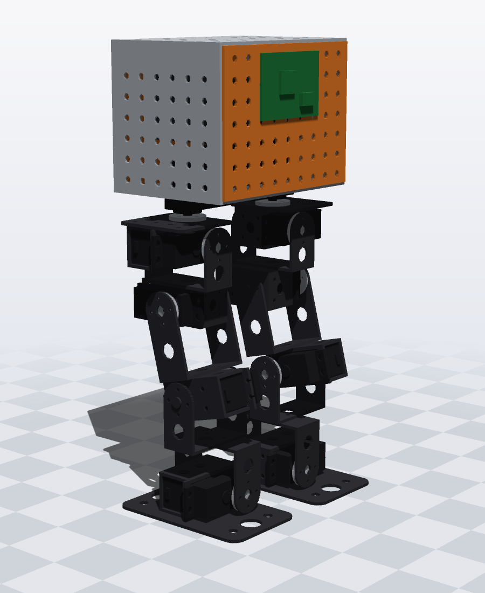
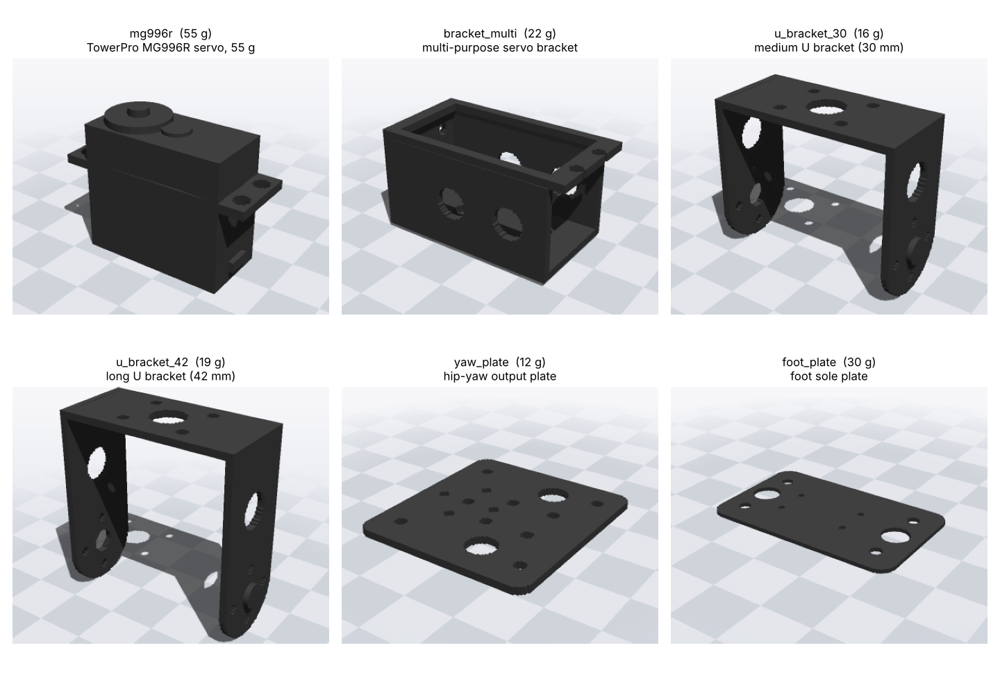

# 10-DoF servo-bracket biped: CAD

A compact biped built from the standard aluminium "robot servo bracket" kit
parts and ten TowerPro MG996R servos, in the style of the classic hobby
biped kits.




## Files

| file | what |
|---|---|
| `biped10_parts.scad` | OpenSCAD part library: `mg996r()`, `servo_horn()`, `bracket_multi()`, `u_bracket(L)`, `yaw_plate()`, `foot_plate()`, body box parts |
| `assembly.scad` | the assembled robot (generated, poses `stand` and `zero`) |
| `export_stl.sh` | export every part to STL with OpenSCAD |

## Layout

Each leg, top to bottom: **hip yaw → hip roll → hip pitch → knee → ankle roll**.

**Body and hip yaw.** The body is a 88 × 124 × 94 mm box (x × y × z). The two
hip-yaw servos stand inside it on their mounting tabs, which rest on the box
floor, with their cases dropping through cut-outs so the shafts point straight
down. The battery sits above them. Under the box, a yaw plate on each yaw
horn carries that leg's hip-roll servo bracket. The yaw axes are 84 mm apart,
on the leg lines.

**Legs.** Every other joint is a "servo unit": a servo held in a
multi-purpose bracket, with a U bracket straddling it (top arm on the horn,
bottom arm on the bracket's bearing). The servos **lie on their side**: each
bracket is bolted to its neighbour by one of its large side walls, so a servo
unit only takes about 26 mm of leg height.

* The hip-roll servo hangs under the yaw plate, shaft forwards, body pointing
  **outwards**. This keeps the space between the hips clear, so the legs can
  turn on the yaw joints without the hips meeting.
* The hip-pitch servo hangs under the hip-roll U, body pointing backwards.
* The knee servo sits under the thigh U, body pointing forwards.
* The shin is two U brackets bolted base to base.
* The ankle-roll servo lies flat across the foot plate, horn facing forwards,
  body pointing outwards.

Each servo body points to the side its joint doesn't need to swing towards.
The joint limits in `Biped10Config` were checked against the bracket
clearances, and against the two yaw links meeting:

| joint | range (rad) | blocked beyond |
|---|---|---|
| hip yaw | −0.5 … 0.5 | yaw links never meet within ±1.0 |
| hip roll | −0.5 … 0.55 | +0.62 (servo body) |
| hip pitch | −1.0 … 1.6 | no limit from the brackets |
| knee | −2.0 … 0.1 | +0.79 |
| ankle roll | −0.6 … 0.6 | +0.79 |

| segment | bracket | axis spacing |
|---|---|---|
| hip yaw horn → hip roll | 2 mm yaw plate + bracket side wall | 15 mm |
| hip roll → hip pitch | 24 mm U | 39 mm |
| hip pitch → knee (thigh) | 42 mm U | 57 mm |
| knee → ankle roll (shin) | 30 mm + 30 mm U, back to back | 64 mm |
| ankle roll → sole | bracket side wall + 2 mm plate | 15 mm |

Hip height is about 0.17 m and total height about 0.30 m. The mass is
about 1.55 kg: 10 × 55 g servos, aluminium brackets, a 250 g battery and a
45 g controller.

## How the simulator uses this

`biped_walker/cad/parts.py` mirrors each OpenSCAD module in NumPy (same
dimensions, same frames). `biped_walker/cad/biped10_design.py` places the
parts, computes masses and inertias, and writes:

* `biped_walker/assets/biped10/meshes/*.stl`: part meshes (mm)
* `biped_walker/assets/biped10/biped10.json`: bodies, joints, inertias, collision boxes
* `cad/biped10/assembly.scad`: this assembly

```bash
python -m biped_walker.cad.biped10_design   # regenerate meshes + model data + assembly.scad
python -m biped_walker.cad.render           # regenerate docs/biped10*.png
```

The NumPy mirror exists so the meshes can be built without OpenSCAD. Its bolt
holes are sampled on a 0.5 mm grid, so they are slightly faceted. For smooth
meshes run `./export_stl.sh --sim` with OpenSCAD installed; dimensions are
identical. **If you change a dimension, change it in both
`biped10_parts.scad` and `parts.py`**, then rerun `biped10_design`.
