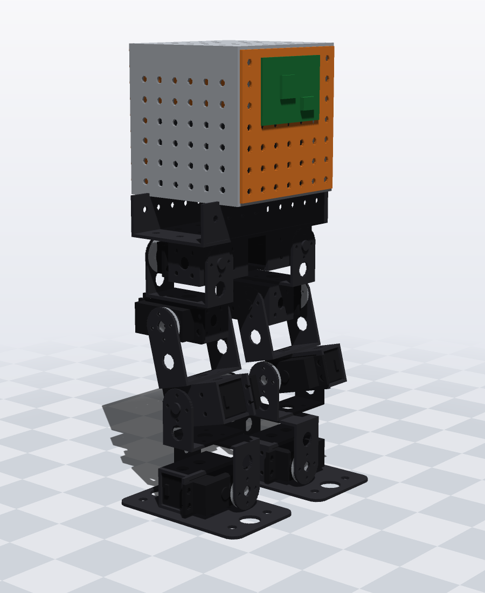
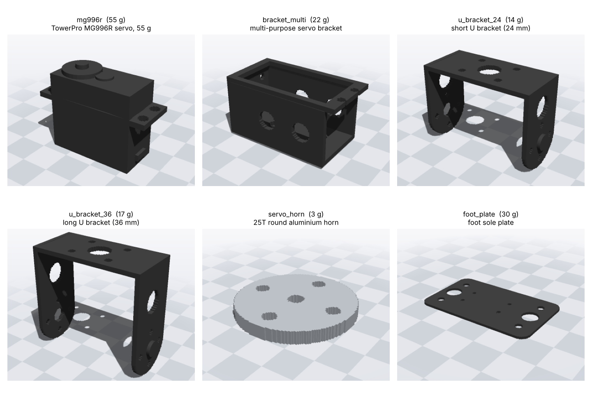

# 8-DoF servo-bracket biped: CAD

A compact biped built from the standard aluminium "robot servo bracket" kit
parts and eight TowerPro MG996R servos, in the style of the classic hobby
biped kits.




## Files

| file | what |
|---|---|
| `biped8_parts.scad` | OpenSCAD part library: `mg996r()`, `servo_horn()`, `bracket_multi()`, `u_bracket(L)`, `foot_plate()`, body parts |
| `assembly.scad` | the assembled robot (generated, poses `stand` and `zero`) |
| `export_stl.sh` | export every part to STL with OpenSCAD |

## Leg layout

Each leg, top to bottom: **hip roll → hip pitch → knee → ankle roll**.

Every joint is a "servo unit": a servo held in a multi-purpose bracket, with a
U bracket straddling it (top arm on the horn, bottom arm on the bracket's
bearing). To keep the legs short and the centre of mass low, **the servos lie
on their side**: each bracket is bolted to its neighbour by one of its large
side walls, so a servo unit only takes about 26 mm of leg height.

* The hip-roll servos lie flat under the pelvis, shafts pointing backwards,
  bodies pointing inwards.
* The hip-pitch servo hangs under the hip-roll U, body pointing backwards.
* The knee servo sits under the thigh U, body pointing forwards.
* The shin is two U brackets bolted base to base.
* The ankle-roll servo lies flat across the foot plate with its horn facing
  forwards and its body pointing outwards.

Each servo body points to the side its joint doesn't need to swing towards,
which keeps the main direction of motion clear. The joint limits in
`Biped8Config` stay inside the bracket clearances: hip roll −0.3…0.6,
hip pitch −0.8…1.6, knee −2.0…0.1, ankle roll −0.6…0.6 rad.

| segment | U bracket | axis spacing |
|---|---|---|
| hip roll → hip pitch | 24 mm | 39 mm |
| hip pitch → knee (thigh) | 36 mm | 51 mm |
| knee → ankle roll (shin) | 24 mm + 30 mm, back to back | 58 mm |
| ankle roll → sole | bracket side wall + 2 mm plate | 15 mm |

The hip-roll axes are 84 mm apart and the feet are 100 × 60 mm plates. Hip
height is about 0.16 m, total height about 0.29 m, and the mass about 1.42 kg
(8 × 55 g servos, aluminium brackets, a 250 g battery and a 45 g controller).

## How the simulator uses this

`biped_walker/cad/parts.py` mirrors each OpenSCAD module in NumPy (same
dimensions, same frames). `biped_walker/cad/biped8_design.py` places the
parts, computes masses and inertias, and writes:

* `biped_walker/assets/biped8/meshes/*.stl`: part meshes (mm)
* `biped_walker/assets/biped8/biped8.json`: bodies, joints, inertias, collision boxes
* `cad/biped8/assembly.scad`: this assembly

```bash
python -m biped_walker.cad.biped8_design   # regenerate meshes + model data + assembly.scad
python -m biped_walker.cad.render          # regenerate docs/biped8*.png
```

The NumPy mirror exists so the meshes can be built without OpenSCAD. Its bolt
holes are sampled on a 0.5 mm grid, so they are slightly faceted. For smooth
meshes run `./export_stl.sh --sim` with OpenSCAD installed; dimensions are
identical. **If you change a dimension, change it in both
`biped8_parts.scad` and `parts.py`**, then rerun `biped8_design`.
